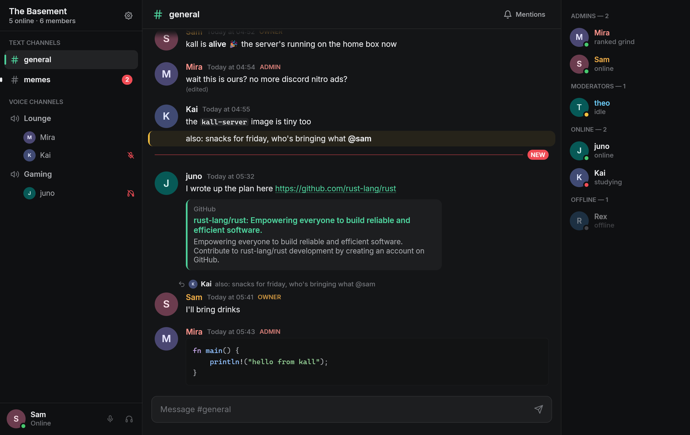
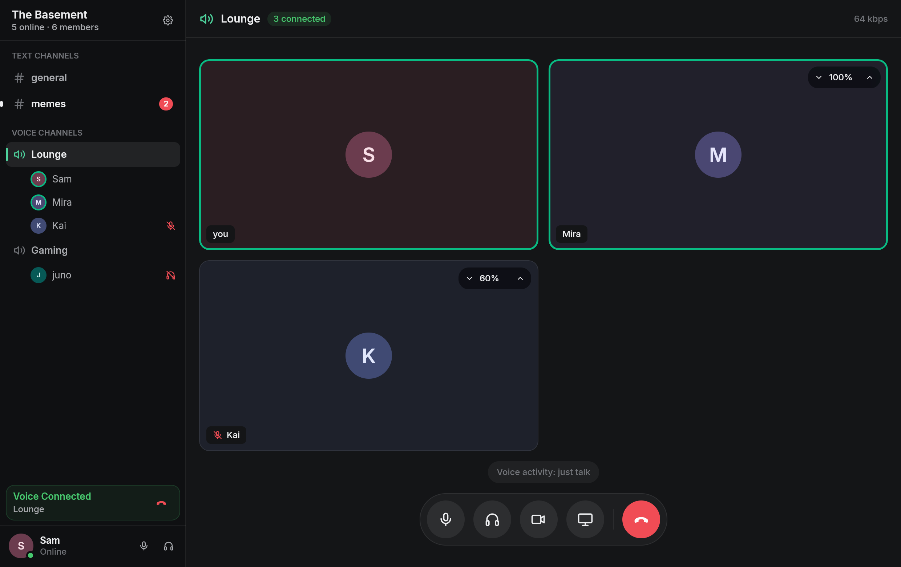
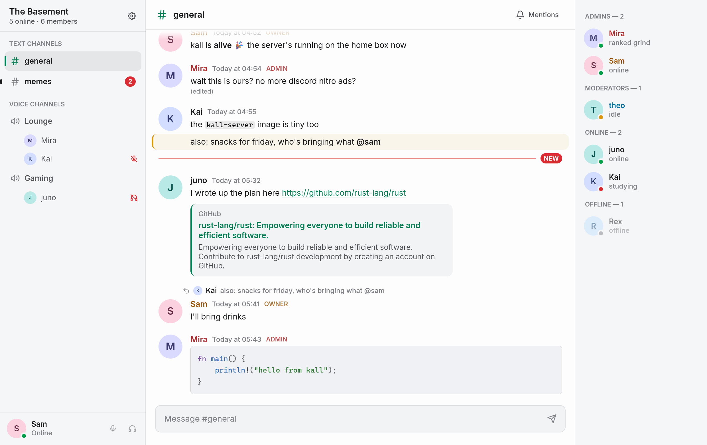

<p align="center">
  <picture>
    <source media="(prefers-color-scheme: dark)" srcset="docs/logo-white.svg">
    
  </picture>
</p>

<h1 align="center">kall</h1>

<p align="center"><strong>Self-hosted voice, video and text chat for one group of friends.</strong></p>

kall is a small Discord-style app you run yourself: one server on a box at home, one desktop
client for everyone. It covers text channels, low-latency voice, screen sharing with sound, and
webcams. It's written in Rust, and the client UI uses [Rune](https://github.com/anomalyco/rune).



<table>
  <tr>
    <td></td>
    <td></td>
  </tr>
</table>

> [!NOTE]
> kall is a young project, built for a group of about ten friends. It works day to day on
> Windows. macOS and Linux builds are written but much less tested (see [Status](#status)).

## Features

- **One server, no sign-up service.** Friends create an account with an invite code you give
  them. The session is kept in the OS keychain, so the app logs back in on launch.
- **Text chat:**
  - Markdown with code blocks.
  - Replies, editing and deleting your messages (↑ edits your last one).
  - @mentions, unread badges, a "NEW" line, a typing indicator and link previews.
  - History is kept forever.
- **Voice:**
  - Opus over QUIC datagrams. The server forwards packets without decoding them (an SFU).
  - Echo cancellation, RNNoise noise suppression and automatic gain control.
  - Voice activity detection, or global push-to-talk that works while a game has focus.
  - Per-friend volume, a device picker and per-channel bitrate.
- **Screen share and webcam:**
  - Share a display or a window, from 720p to 1440p at 30 fps.
  - Optionally share system sound, minus kall itself so nobody hears their own voice back.
  - Several people can share at once. Video is sent only to the people watching.
- **Desktop app:**
  - Per-channel notifications and sound cues.
  - A tray icon with an unread badge, and close to tray.
  - Optional start at login, and dark and light themes that follow the system.
  - Signed auto-updates.
- **Moderation:**
  - Owner, admin, mod and member roles, with kick and ban.
  - Mods and admins can delete messages and create invites with use limits and expiry.
  - Admins manage channels from inside the app.
- **Easy hosting:**
  - A Docker image that listens on a single UDP port.
  - Automatic Let's Encrypt certificates through Cloudflare DNS.
  - Built-in dynamic DNS for a home connection.

## How it works

Each client keeps one QUIC connection to the server on one UDP port (`7744` by default):

- **Control stream:** chat, presence and signalling.
- **Unreliable datagrams:** voice and video, for the lowest latency.

The server stores everything in SQLite and forwards media between clients without decoding it.
[ARCHITECTURE.md](ARCHITECTURE.md) has the details.

## Hosting a server

You need a machine that stays on, one forwarded UDP port, and ideally a domain on Cloudflare.

```sh
cd deploy
cp .env.example .env      # set KALL_NAME, KALL_DOMAIN and CF_API_TOKEN
docker compose up -d --build
docker compose logs kall  # the first start prints the owner's invite code
```

[deploy/README.md](deploy/README.md) covers the details: the Cloudflare token, port forwarding,
running without a domain, and IPv6 and CGNAT. Without a domain, clients connect by IP and pin the
server's self-signed certificate the first time.

Mint more invites with:

```sh
docker compose exec kall kall-server invite --uses 1 --hours 168
```

Friends can also get invites from Settings → Invites in the app, if they're a mod or admin.

## Getting the app

Download the installer for your system from the
[Releases](../../releases/latest) page:

| System | Package |
| --- | --- |
| Windows | `kall_x.y.z_x64-setup.exe` (per-user, no admin needed) |
| macOS | `.dmg` (Apple Silicon and Intel) |
| Linux | `.AppImage` or `.deb` |

The builds aren't code-signed yet:

- **Windows:** SmartScreen will warn you. Choose *More info → Run anyway*.
- **macOS:** the first time, right-click the app and choose *Open*.

After that, kall keeps itself up to date. Every update is checked against a signing key that's
built into the app.

Open kall, choose **Create account**, and enter the server address, your invite code, a username
and a password.

## Building from source

You need the Rust toolchain pinned in [`rust-toolchain.toml`](rust-toolchain.toml) (rustup
picks it up), plus CMake and NASM for the media codecs. On Linux, you also need the
development packages listed in [`.github/workflows/release.yml`](.github/workflows/release.yml).

```sh
cargo run -p kall-server -- --name "My Server"   # prints the owner invite on first run
cargo run -p kall                                # then Create account → paste the invite
```

To try two clients on one machine, give each its own profile so they keep separate logins:
`KALL_PROFILE=alice cargo run -p kall`.

### Server options

| Flag | Environment | Meaning (default) |
| --- | --- | --- |
| `--data DIR` | `KALL_DATA` | database and certificates (`data`) |
| `--bind ADDR` | `KALL_BIND` | UDP address to listen on (`[::]:7744`) |
| `--name NAME` | `KALL_NAME` | the server's display name (`kall`) |
| `--domain D` | `KALL_DOMAIN` | public name, e.g. `kall.example.com` |
| | `CF_API_TOKEN` | Cloudflare token (DNS:Edit and Zone:Read); turns on Let's Encrypt and DDNS |
| `--email E` | `KALL_ACME_EMAIL` | contact for Let's Encrypt expiry mail (optional) |
| `--staging` | `KALL_ACME_STAGING=1` | use Let's Encrypt's staging CA |
| `--no-ddns` | `KALL_DDNS=0` | don't update the A/AAAA record |
| `--ipv6` | `KALL_DDNS_IPV6=1` | also publish an AAAA record |

### Tests

```sh
cargo test --workspace                                # protocol, server (real QUIC end-to-end), voice DSP
docker compose -f deploy/pebble.compose.yaml up -d    # then the ACME flow against a local Pebble CA:
cargo test -p kall-server --test acme_pebble -- --ignored
```

The client renders its screens headlessly from demo data. This is handy for UI work:

```sh
cargo run -p kall -- --list-scenes
cargo run -p kall -- --snap chat.png --scene chat --theme light
```

## Releasing

Releases are built by [`.github/workflows/release.yml`](.github/workflows/release.yml) whenever
a `v*` tag is pushed:

1. Bump `version` in the root `Cargo.toml` and commit.
2. Tag the commit and push the tag: `git tag v0.2.0 && git push --tags`.

CI then:

- builds and signs the installers for each platform;
- publishes a GitHub Release with the `latest.json` update manifest;
- pushes the server image to `ghcr.io/<owner>/<repo>-server`.

The workflow needs two repository secrets:

- `CARGO_PACKAGER_SIGN_PRIVATE_KEY`: the minisign private key whose public half is
  [`crates/client/updater.pub`](crates/client/updater.pub).
- `CARGO_PACKAGER_SIGN_PRIVATE_KEY_PASSWORD`: its password (empty if it has none).

Installed clients only accept updates signed with that key, so keep a backup of it. Forks should
generate their own key with `cargo packager signer generate` and replace `updater.pub`.

## Status

What has been tested so far:

| Area | Windows | macOS | Linux |
| --- | --- | --- | --- |
| Text, voice, settings | ✅ tested | 🟡 untested | 🟡 untested |
| Screen share | ✅ 1080p30 | 🟡 untested | 🟡 untested |
| System sound in shares | ✅ | ❌ not yet | ❌ not yet |
| Webcam | 🟡 untested | 🟡 untested | 🟡 untested |
| Notifications, tray | ✅ mostly | 🟡 untested | 🟡 untested |
| Installers, auto-update | 🟡 local only | 🟡 untested | 🟡 untested |

On the roadmap: hardware video encoding, direct messages, and file uploads in chat.

## Project layout

```text
crates/proto    wire protocol shared by client and server
crates/server   kall-server
crates/client   the kall desktop app (ui/, voice/, video/)
deploy/         Docker Compose setup and hosting guide
scripts/        release helpers
```

## License

[MIT](LICENSE)
